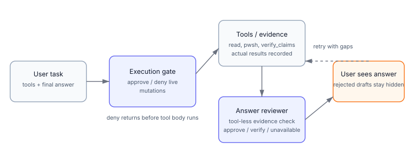

# dsh-doubt

[](https://github.com/Yangxingyu789/dsh-doubt/actions/workflows/ci.yml)
[](https://github.com/Yangxingyu789/dsh-doubt/releases/latest)
[](LICENSE)
[](https://nodejs.org)
[](https://github.com/deepseek-ai/deepseek-harness)
[](#requirements)
[](https://github.com/topics/dsh-plugin)
[](https://github.com/Yangxingyu789/dsh-doubt/actions/workflows/ci.yml)


<p align="center"></p>

A completion guard for [DeepSeek Harness](https://github.com/deepseek-ai) (DSH) agents.
It checks the *real tool evidence* behind an answer before that answer is shown, so a
model cannot pass off an unverified claim as a completed task.

## Why

Agent answers often sound finished before the work is actually verified: a file was
written but never read back, a dependency was guessed, a command was never run. The
default failure mode is confident prose plus an unsupported claim.

`dsh-doubt` adds a review boundary at the end of the turn. It does not ask the model
whether it is sure; it checks what actually happened in the session.

## What it does

- **Pre-execution gate** — dangerous live-host mutations (writes into `.dsh/profiles`
  or `.dsh/plugins`, process kills, service/registry changes, recursive deletes, system
  directories) are routed through the host approval seam; with no approval channel they
  are denied before the tool body runs.
- **Final-answer review** — before a final answer is displayed, a tool-less reviewer
  compares every actionable claim (commands, paths, versions, symbols, measured numbers)
  against the turn's actual tool calls and results. Rejected drafts are never shown;
  when review cannot complete the draft is released fail-open with an explicit status.
- **`verify_claims` tool** — runs submitted checks locally (command / file / HTTP /
  expression) and returns measured output, so claims can be grounded in real results.
- **Provenance for deliverables** — when a Markdown/TXT deliverable is written without
  inline source annotations, a step-by-step provenance table is requested.
- **Live-mutation guard** — an executed live mutation must disclose a backup location,
  an executable rollback command, and a post-action health check.

The review is an evidence check, not a correctness guarantee.

### Token usage and loop protection

Internal `doubt_review` receipts are hidden from the model's tool list while
remaining executable by the host. Stale model-authored receipt calls cannot spin
the agent indefinitely: other tools in a mixed response still run; a receipt-only
response stops with an explicit incomplete-verification notice. Normal automatic
evidence recovery remains available. Review-attempt logs include provider-reported
token counters when available; missing usage is unknown, not zero. See the
[token audit](docs/token-audit-2026-10-21.md) for scope and verification details.

## How it fits together



Tool calls pass through the execution gate; the final answer passes through a tool-less
evidence review before display. See [architecture](docs/architecture.md) for the
boundaries and [configuration](docs/configuration.md) for every option.

## Requirements

- Node.js `^22.19` or `>=24`
- DSH desktop app or host bundle for the integration tests (`verify:host*`)
- Tested against DSH desktop runtime `0.2.1-rc.2`; see [compatibility](docs/compatibility.md)
- Windows is the primary platform; Linux/macOS are supported for development and CI

## Install

### DSH plugin manager (recommended)

```bash
dsh plugin --profile web add github:Yangxingyu789/dsh-doubt#v0.1.5
```

Restart the harness and refresh the UI; the plugin is managed under **Settings → Plugins**
and can be enabled or disabled there. Pin a tag or commit for reproducible installs.

### Windows desktop (offline installer)

Download the `dsh-doubt-0.1.5-source.zip` release asset (or clone the `v0.1.5` tag),
then run PowerShell from the unpacked source directory:

```powershell
pnpm install
node .\scripts\install-local.mjs --profile desktop
cd "$env:USERPROFILE\.dsh\profiles\desktop"
pnpm install --offline
```

The installer builds the plugin, copies `lib/`, config, assets and docs into
`$DSH_HOME\plugins\dsh-doubt`, backs up the profile `package.json`, and adds the
dependency and bundle to the selected profile. Back up the existing plugin directory
first if you are upgrading. Restart DSH afterward; if the plugin is disabled in the
profile config, enable it explicitly.

Use `--profile <name>` for a profile other than `desktop`. The profile directory must
already exist.

### From source

```bash
git clone --branch v0.1.5 https://github.com/Yangxingyu789/dsh-doubt.git
cd dsh-doubt
pnpm install
node scripts/install-local.mjs --profile desktop
```

For development rather than installation:

```bash
pnpm install
npm run build
npm test
```

## Quick start

After restarting DSH, ask a question that requires real evidence, for example:

> Read `package.json` and answer with only its version.

The final answer is held until the review compares it with the actual `read` result.
Use `verify_claims` when you want a claim checked directly. Review attempts are logged
as `审核用量` with character counts and provider usage; prompts, tool payloads and
credentials are not logged.

## Configuration (excerpt)

All options live under the plugin's `config:` block (see [cordis.patch.yml](cordis.patch.yml)).

| Key | Default | Meaning |
|---|---|---|
| `guardPreExecute` | `true` | Ask/deny dangerous live mutations before the tool runs |
| `guardLiveMutation` | `true` | Require backup + rollback + health check for executed live mutations |
| `requireOperationEvidence` | `true` | Review the final answer against tool evidence |
| `reviewMaterialOnly` | `true` | Skip the reviewer when a draft has no actionable claims |
| `reviewNotice` | `off` | Trailing notice after an incomplete review: `banner` / `short` / `off` |
| `requireProvenance` | `true` | Require a provenance table for annotation-free deliverables |

## Versioning and release history

- **Public release series: `0.1.x`.** The first public release was `0.1.0`.
- `0.7.x` and `0.8.x` tags are pre-public development history. They are not installation
  targets and do not sort as newer public releases.
- Use the latest `v0.1.x` GitHub Release and its source asset. The plugin version is
  reported in `package.json`, `dsh-plugin.json` and the runtime plugin banner.

## Limits

- The gate and scanner are heuristics over commands and text; unusual quoting, variables,
  nested shells or otherwise encoded payloads can be classified conservatively
  (deny/ask) or missed. **The gate is not a security boundary.**
- The final review depends on a model provider call. When it cannot complete, the answer
  is released fail-open; logs record the failure but the default `reviewNotice: off`
  does not add a visible notice. Review also consumes model tokens.
- The reviewer checks evidence, not semantic correctness or user intent. A claim that is
  a restatement of the user's own wording can be treated as user context rather than a
  new factual assertion.
- Windows is the primary target; Linux/macOS support covers development and CI.
- The public `0.1.x` interfaces and config keys may change.

## Security

See [SECURITY.md](SECURITY.md) for private vulnerability reporting. Do not open a public
issue containing credentials, tokens, local session content or exploitable payloads.

## Development

```bash
npm run check          # tsc --noEmit
npm run build          # compile to lib/
npm test               # 12 unit test files
npm run smoke          # load the plugin in a bare Cordis app
npm run audit          # repository consistency checks
npm run verify         # full chain, including host tests when DSH_APP_DIR is available
```

Contribution notes are in [CONTRIBUTING.md](CONTRIBUTING.md). The full documentation
index is in [docs/README.md](docs/README.md).

## Verification provenance

Historical verification snapshots, commands and known limits are recorded in
[docs/provenance.md](docs/provenance.md). The token-audit record is in
[docs/token-audit-2026-10-21.md](docs/token-audit-2026-10-21.md).

## License

MIT — see [LICENSE](LICENSE). Changelog: [CHANGELOG.md](CHANGELOG.md).
